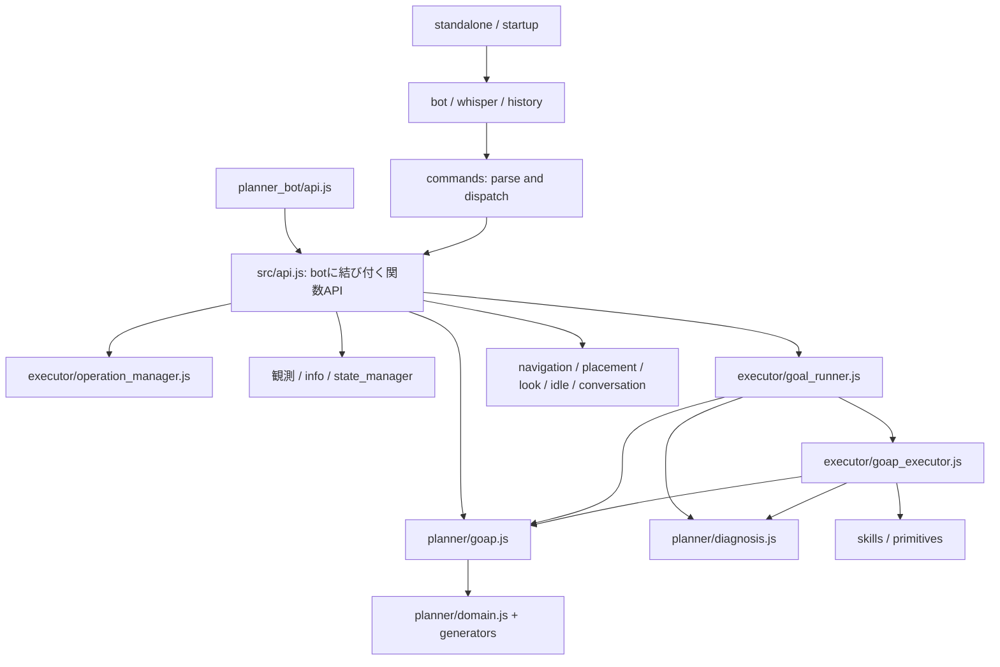

# ② リファクタリング計画（承認済み）

2026-10-09（日本時間）。担当：②リファクタリングエージェント。
作業ブランチ：`refactor/isg-2026-10-09`。基準：master `db2b29e`、①のテスト `a27be58`、引き継ぎ文書 `19c3356`。
この文書は実装前の提案。現時点で本体・テスト・API.md・.gitignore は変更していない。

## 前提と確認済み事項

README、最優先の `00_decisions.md`、`00_observations.md`、`00_refactor_proposal.md`、`00b_code_inventory_result.md`、`01_refactor.md`、`tests/README.md` を読み、関係するコードとテストを確認した。
2026-10-09 の追加指示と更新済み README・00_decisions により、GPU と vision の実行テストは許可済み。再確認は不要。依頼者の Minecraft クライアントには触れない。

- 変更前の `npm test`：157件成功、失敗0、TODO0、30.7秒。
- 変更前の `npm run test:known`：refresh と循環依存の2件が既知失敗のTODO。終了コード0でも成功と数えない。
- 今回の計画作成段階ではサーバー・viewer・ブラウザを起動していない。
- 現ブランチは指定どおり。master の変更・merge・push は行わない。

現行版の GOAP の選び方・環境利用・実行手順を基準にする。設置済みの板・作業台・かまど・チェストも材料として使えること、数値目標が現在の所持量に対する追加取得であることを維持する。機能の削除は提案しない。

## 現構造と変更後の依存

| 層 | 現在の担当 | 問題・維持する責務 |
|---|---|---|
| 起動・bot | `planner_bot/index.js`、`bot/startup.js`、`bot/ai_bot.js` | 単体/複数起動、whisper、自然言語イベント、履歴を維持。ルートpackageのmainは存在しないファイルを指す |
| コマンド | `commands/index.js` と各ハンドラ | 文字列解析以外に停止・実行・観測が混在。関数APIの薄い入口にする |
| GOAP実行の統括 | `commands/goal_command.js` | 道具事前準備、数量削減、補助目標、再帰深度/循環チェックがある。全処理を順序ごと保持して移す |
| 計画 | `planner/goap.js`、`state_builder.js`、generator群 | A*、条件/効果、診断、YAML読み込み。domainとactiveLoggerがmoduleで共有される |
| 実行 | `executor/goap_executor.js`、`precondition_checker.js` | 前提再検査、逆転前提のスキップ、補助計画、再計画、中断を維持。診断をcommandsから逆参照している |
| 観測 | `planner/state_manager.js`、scanner、info | refresh中にyieldし、共有cacheとsilentRefreshを更新する。並行観測用の局所状態が必要 |
| 操作 | `skills/`、`primitives.js`、`navigation/actions.js` | 9スキル、移動、追跡、装備、採集、設置、チェスト。共通機構を抽出しても個別の既定値を維持 |
| 横断 | logger、vision、会話処理 | ログ制御を集約。visionは未定義loggerを最小修正し、従来の撮影/後処理を検証 |

変更後の依存案：



既存の planner / executor / skills / navigation / bot / commands / utils の配置を保つ。新しい巨大なservices階層や別プロジェクトは作らない。`src/api.js` はbot生成をrequireせず、公開入口 `planner_bot/api.js` がbot生成とAPIのexportをまとめることで、bot→commands→API→botの循環も避ける。

## 関数APIの案

ルート `package.json.main` を `planner_bot/api.js` に変更する。requireだけでdotenv読込・サーバー接続・複数bot起動はしない。
`createAIBot` は既存の同期factoryとして公開し、`createBotApi(bot, options)` でそのbotに対するAPIを取得する。同じbotのAPIを複数作っても操作管理は共有する。

以下のAPIメソッドはすべて `Promise<Result>` を返す。初期化用factoryと内部の低レベル関数はこの結果契約の対象外として文書で区別する。

```js
// 成功。戻り値を持たない操作もdataはnullとする。
{ ok: true, data: /* 操作ごとのデータ、またはnull */, error: null }
// 失敗。detailsを省略せず、情報がない場合もnullとする。
{ ok: false, data: null, error: { code: '...', message: '...', details: /* objectまたはnull */ } }
```

| メソッド案 | 内容・入力 | dataの主な内容 |
|---|---|---|
| `observe()` | 現行と同じ範囲で新しいworldStateを取得 | worldState。03の高速観測は先取りしない |
| `refresh()` | 実行側の状態cacheを更新する明示操作 | durationMs |
| `planGoal(goal, { worldState } = {})` | 状態指定時はその状態だけで計画。省略時は独立観測。接続版のdomainを必ず準備 | 現行と同じplan/diagnosis（計画可能時）。計画不可時はerror.detailsに診断 |
| `executeGoal(goal, { signal } = {})` | 道具準備・補助目標・実行・再計画を含む現行!goal全体 | goal、完了messageなど |
| `executeSkill(name, params, { signal } = {})` | 9スキル。現行の実行前後のrefreshを維持 | スキル名、返り値があればresult |
| `executePrimitive(name, params, { signal } = {})` | 公開primitive群。snake_case名も解決 | primitive名、実際のresult |
| `navigate(action, params, { signal } = {})` | register/goto/gotoCoords/方向4種/follow/stopFollow/drop/pickup/chest4種 | 従来の結果内容から成否フィールドを分離 |
| `placeBlock(params, { signal } = {})` | 現creativeのname/coords/allowSelfPosition | block、position、message |
| `info(type, params)` | all/vision/scanBlocks/recipesFor/recipesUsing | 既存の情報data |
| `status()` | 現statusの状態確認・表示 | 状態情報。ログだけだった結果も取得可能にする |
| `look(action, params)` / `startIdle(params)` | direction/dir、player/at、watch、idle | 現行の角度・対象・開始情報 |
| `stop()` | 全実行・追跡・idle・watch・開いたチェストを停止 | stoppedActions、message |
| `chat(params)` / `echo(username, message)` | 距離付きwhisper、echo | 従来の送信結果 |
| `addMessage(speaker, content, type)` / `history(options)` | 手動履歴追加、全体/ユーザー別/type別取得 | 追加結果、history/count/latestSequence |
| `speak(username, message)` / `speakNearby(message, radius)` | 既存の直接送信機能 | 送信完了情報 |

API側でチャット文字列を組み立てて既存ハンドラへ戻す実装にはしない。業務処理を既存の各領域に切り出し、commandは解析してAPIを呼ぶ。look/idle/info/statusも解析と処理を分離する。
`!idle_on` を維持し、現行で認識されない `!idle` を新しい機能として追加しない。lookの別名・chatの簡易/JSON形式・historyのカンマ区切り・primitiveの名前変換を維持する。

エラーcode案：`INVALID_ARGUMENT`、`UNKNOWN_COMMAND`、`UNKNOWN_ACTION`、`UNKNOWN_SKILL`、`UNKNOWN_PRIMITIVE`、`BOT_NOT_READY`、`PLAYER_NOT_FOUND`、`ENTITY_NOT_AVAILABLE`、`OUT_OF_RANGE`、`LOCATION_NOT_FOUND`、`ITEM_NOT_FOUND`、`CHEST_NOT_OPEN`、`PLACEMENT_FAILED`、`PLAN_NOT_FOUND`、`ENVIRONMENT_MISSING`、`GOAL_CYCLE`、`GOAL_DEPTH_EXCEEDED`、`REPLAN_FAILED`、`CANCELLED`、`TIMEOUT`、`VERSION_CONFLICT`、`DOMAIN_PREPARATION_FAILED`、`OPERATION_CONFLICT`、`EXECUTION_FAILED`、`INTERNAL_ERROR`。
入力検証・既存reason/exceptionの発生箇所でcodeを付ける。日本語メッセージの文字列一致だけで失敗理由を分類しない。`diagnosis`、`missingPreconditions`、`missingEnvironment`、`needsLLM`、`goalChain`などはdetailsへ残す。
未知の例外も公開APIではINTERNAL_ERRORにそろえ、内部では原因を追えるログを保持する。チャット入口も同じResultを返す。creativeの内側が失敗なら外側もok:falseとする（決定事項1）。

## 同時実行・停止仕様の案

操作管理はbotごと。同一プロセスの複数botは互いを停止しない。観測・計画は操作の排他枠を使わず、実行途中にも呼べる。
API/チャットのどちらから始めても、新しい移動・実行を受け付けたら前の操作を中断する。同時要求A→B→Cでは最新のCだけが実行を開始し、停止待ちのBはCANCELLEDになる。

| 新しい呼び出し | GOAP/skill/primitive/単独移動 | follow | idle/watch | open chest | 備考 |
|---|---|---|---|---|---|
| observe / planGoal / info all・scan・recipes / status | 継続 | 継続 | 継続 | 継続 | stopAllを呼ばない |
| refresh | 継続 | 継続 | 継続 | 継続 | cacheへの公開は完了した状態のみ |
| executeGoal / executeSkill / executePrimitive / placeBlock | 中断 | 停止 | 停止 | 閉じる | 移動・装備・craft・採掘・container操作の所有者を1つにする |
| navigate goto/gotoCoords/moveInDirection/follow/dropItem/pickupItems/chestOpen | 中断 | 停止 | 停止 | 閉じる | follow開始後も所有権を保持する |
| navigate register / stopFollow | 中断 | 停止 | 停止 | 閉じる | 現navigation入口の自動停止を維持。stopFollowの「追跡していません」という観察済み挙動も保持 |
| navigate chestDeposit/chestWithdraw/chestClose | 原則同居しない | 原則同居しない | 継続可能 | 維持して続行、closeは閉じる | open chestのセッション内で逐次実行。続行前にstopAllしない |
| look direction/player/watch、startIdle | 継続 | 継続 | 現行の各ハンドラの置換/解除規則に従う | 継続 | 現行の独立した視線操作を維持。新しい移動・実行とstopで解除する |
| chat | 継続 | 継続 | 継続 | 閉じる | 現コードは会話前にチェストだけ閉じる |
| echo / history / addMessage / speak / speakNearby | 継続 | 継続 | 継続 | 継続 | 会話履歴への自動追加はしない |
| stop | 中断 | 停止 | 停止 | 閉じる | 対象がなくても成功 |
| info vision | 継続 | 継続 | 継続 | 継続 | 方向指定と並行性の扱いは下の確認事項V |

チェスト操作の非同期呼び出しが重ならないよう、セッション内で逐次化する。新しい実行/stopが来たら待機中の続行要求も中断する。count=-1のアイテム選択/転送アルゴリズムは変更しない。

中断の実装では以下を守る：

1. 外からのAbortSignal、stop、新操作による置換を、同じ内部AbortControllerへつなぐ。すでにabortされた要求は既存実行を停止せずCANCELLEDを返す。
2. pathfinder goal解除・掘削停止を行い、skill/primitive/navigationのawait境界・採集/回収/精錬ループ・goal再帰に中断チェックを渡す。中断を通常失敗として再計画/次候補/数量削減に進めない。
3. 古い処理のPromiseを単にraceで捨てない。中断できない進行中のMineflayer操作は終了を待ち、それ以降の副作用を出させず、新操作の開始前に後処理まで完了させる。停止の返り値は後処理の完了を意味する。
4. operationの所有者を照合してcontroller・container・timerを解除する。古いfinally/abort listenerが新しい操作のcontrollerやgoalを消さないようにする。
5. followは開始Promiseが返っても継続状態として保持する。idle/watchは停止後に進行中tickが新しい視線操作を発行しないよう確認する。精錬中に開いたfurnaceもfinallyで閉じる。

これらは決定事項2のための中断拡張であり、通常成功時の既定距離・待機時間・探索回数・失敗回復方針は変えない。中断不能な通信操作の完了待ちがあり得るので、即座の物理停止を全Mineflayer操作に保証するとは記載しない。

観測はStateManagerの観測部分を「状態を組み立てて返す処理」とcache公開に分離する。observe/infoは呼び出し専用の状態を使い、実行側cacheやsilentRefreshを上書きしない。refreshの公開は世代を管理して遅い古い要求が新しいcacheを戻さないようにする。実行側の明示refreshは現行箇所に残す。
planは入力を変更せず、最初に選んだdomainをその呼び出しのローカル参照として使う。activeLoggerは呼び出しごとのcontextへ移し、並行planや再計画のログが混ざらないようにする。

## domain・生成キャッシュ

- 保存先案：リポジトリルート `.cache/minecraft-bot/actions/<Minecraft版>/`。1.20.1では4ファイル（gather/hand_craft/workbench_craft/equipment）。手書き定義・schema・categoryは既存配置のまま。
- **.gitignore変更案**：`/.cache/minecraft-bot/` を1行追加する。この計画への確認を受けてから変更する。`*.md` の規則は変えず、引き継ぎ文書は必要に応じforce-addする。
- 初回準備でプロセスの使用版を決定する。botに結び付く入口は接続後のbot.versionを使い、未spawnならBOT_NOT_READY。独立した低レベルplanは明示version、既に準備した版、MC_VERSION、既存の1.20.1既定値の順で解決する。異なる版を同じプロセスで要求したらVERSION_CONFLICTとし、実行中domainを差し替えない。
- 各プロセスの初回はその版で生成をやり直し、同プロセスの以後の呼び出しは共通の準備Promise/domainを再利用する。これにより前回起動の古い生成物を無検証で使わない。永続キャッシュ再利用の高度な署名設計は今回必須にしない。
- 出力先をgeneratorへ渡す。4ファイルの生成完了・読込可能性を確認してからdomainを公開する。生成/保存失敗では古い追跡YAMLへ黙って戻さず準備失敗を返す。失敗した準備Promiseを永久固定しない。
- `!goal`、関数planGoal、低レベル`goap.plan`と`collectShortages`が共通prepareを通る。低レベルplanの既存3引数と `{plan, diagnosis}` は内部互換として維持し、必要なら第4引数にversion指定を足す。
- 同期のloadDomain/getAllActions/前提検査は準備済みdomainを読む。未準備時の扱いを明示し、呼び出し元・テストも準備を行う。計画が生成前のdomainをcacheする順序はなくす。
- 生成actionの内容・配列順・コスト・生成側優先と静的fallbackの規則を維持する。現1.20.1のgenerated読込順（equipment→gather→hand_craft→workbench_craft）と静的ACTION_FILES順をgoldenで確認する。
- 追跡中 `config/actions_generated/` は実行時の参照/出力先から外す。今回の計画では基準資料として残し、役割を文書化する。テストfixtureは別の正解データとして保持する。旧backupを新しいcacheに作り直す必要はない。

## 抽出とログの範囲

1. `planner/diagnosis.js`へcheckCompositeState/buildStructuredDiagnosisとその依存helperを移し、runner/executorの両方から読む。executor→commands依存をなくす。
2. `executor/goal_runner.js`へgoal orchestrationを移す。道具準備・数量削減・不足量計算・環境診断・補助目標・maxDepth/attemptedGoalsを省略しない。
3. creativeの処理を`navigation/placement.js`等へ移し、設置探索は共有の候補判定器へpolicyを渡す。skillは6候補の順番、下だけの参照、失敗時に次を試すことを保持。creativeは半径5の3D列挙、距離sortの同順位順、隣接6方向、自分のXZ列除外、座標指定、移動後の再検査を保持。
4. 回収・移動・装備の似た実装は一覧を報告する。timeout、距離、巡回、試行数、失敗の扱いが違うため、今回まとめるのは同一と確認できた機構だけ。collect_dropsとpickupItemsを一括置換しない。
5. ログはcreateLoggerに集約し、レベルとcommand/categoryのフィルタを1か所で適用する。bot.systemLog・PLANNER_DEBUG・silentRefreshは共通設定へ橋渡しし、二重フィルタをなくす。観測/計画のcommand名をbot上の一時共有値だけに依存させない。詳細state/探索iterationはdebugへ移し、APIからlogLevelを指定できるようにする。
6. `goap.js`はdomain読込、目標構文、条件/効果/状態アクセス、関連変数、heuristic、heapを責務ごとに抽出する。探索loopは中心ファイルに残す。関数を渡す/呼び出しcontextを使い、抽出先相互の循環を作らない。各抽出で70件を比較する。列挙順・heap同コスト順・初期化順は変更しない。
7. refreshの未定義setCommandとvisionの未定義loggerを最小修正する。logger修正後に新しいvision失敗を発見した場合、未承認の挙動修正を混ぜず、原因と必要な追加変更を報告する。

## ①bの指摘と今回変更しない動作

| 指摘/対象 | 01での扱い |
|---|---|
| mainが存在しないindex.js | 新しい副作用のない入口へ変更（決定事項で許可済み） |
| 未使用dependency.yaml | そのまま残し、未使用と文書化。削除や新たな利用はしない |
| allowedHand/allowedWorkbench、isHandAllowed | 未使用であることを記録し、今回は残す。静的許可レシピのfilterを有効にしない |
| コメントアウトRESOURCE_LIMITS | コメントの状態も含め維持。有効化しない。探索改善は02以降 |
| domainが生成後に更新されない | 共通prepare→loadの順序に整理。実行中reload機能は追加しない |
| 履歴の自動追加がない | 現行どおり手動追加のみ。API.mdの誤記を直す |
| creativeの外側successとundefined/throw | 決定事項1に従い新しいResultへ変更。ワールドへの作用は維持 |
| statusの古いコマンド案内、API.mdの誤記 | !navigation、実スキル名、正しいexport、yaw90°=西、履歴、実パラメータへ訂正。存在しないCLAUDE.md参照は除去 |
| chest count=-1、自然地形のfurnace遅延 | 02へ。元地形の90秒中断は観察として残し、01の受入条件にしない |
| applyEffectsコピー、カテゴリ/複合状態 | 移動前後で非破壊性と結果を検査。推測で意味を修正しない |

性能改善、目標候補一括評価、所要時間見積り、高速観測、常設ブラウザ、自然言語の理解/JEV選択、建築物保護は03または別依頼。今回先取りしない。

## テスト方針と機能維持表

①のfixturesを正解とし、採り直さない。`observe:*`、capture-offlineによるgolden更新はしない。
5状態×14目標のaction/skill/params/costの順番とdiagnosis全体、facts5件、generatorのaction配列を同じ値で比較する。

157件を起点に、承認済みのResult・停止・生成lifecycle変更に対応するアダプタのassertだけを更新する。計画goldenや動作値を新コードに合わせて書き換えない。更新理由は報告に一覧化する。
knownのrefresh・循環依存はTODOを外してnpm testの通常検査へ移す。visionもTODOを外し、独立したGPU実行で本当の成功/失敗を判定する。

| 維持する機能 | サーバーなしの検証 | 実サーバーの検証 |
|---|---|---|
| GOAP計画・診断・環境ブロック利用 | planner golden70件、facts、数値追加、未知目標、入力非破壊 | 関数と!goalの両入口で確認 |
| GOAP実行・補助目標・数量削減・再計画 | executor既存検査、runnerの事前準備/再帰経路、診断失敗の回帰追加 | 資源配置区画の自然3目標（木/石ツルハシ・furnace）、flat成功/不能目標 |
| 中断・置換・外部AbortSignal | 実行中/開始前/完了後abort、A→B→C、古いfinally、listener除去、2bot独立 | !stop、signal中断、goal→移動と移動→goal。副作用の継続がないこと |
| 9スキル・primitive8種/道具helpers | 既存テスト、API引数/結果、abort境界 | flat既存の採集/作成/精錬/設置/装備/移動/回収/探索 |
| register/goto/gotoCoords/方向4種 | navigation既存値・verticalModeを維持 | flat登録/移動、方向。aboveの地面なし失敗も保持 |
| follow/stopFollow/dropItem/pickupItems | 停止範囲、既定値、フィルタ、結果code | flat追跡、停止、相手近く/その場のdrop、実item回収 |
| chestOpen/Deposit/Withdraw/Close | セッションと逐次化、未open/不正値のcode、stop競合 | flatの通常countで転送・close・stop・chat時close |
| creativeとskillの両設置policy | 6候補順、3D候補/同距離順、参照方向、失敗後次候補 | flatの座標指定/省略・設置済み位置失敗、skill設置 |
| info all/scan/recipes/status/refresh | 情報のpayload、yaw90西、refresh成功、実行と観測並行 | flat全種類、refresh中も実行のcontroller/動作を維持 |
| vision | logger生成・例外時browser/viewer後処理を代用依存で検査 | 許可済みGPUでPNG signature/画像内容/metadata/yaw/pitch、終了後viewer/ブラウザを確認 |
| whisper/chat/history/echo/自然言語event | bot/commands既存検査、100件FIFO/sequence/filter、custom hook、autoHandleWhisper:false、speakNearby/chatWithDelay | peer botでcommand/natural whisper、距離付きchat、echo、手動履歴 |
| look/idle/watch | 別名、既定値、tick停止、stop後の再発行なし | flat方向/player/watch/idle/stop |
| 接続版からの自動生成 | 1.20.1生成golden、初回plan→goal/逆順、同時prepare、準備失敗再試行、version conflict、追跡ファイル不変 | 両サーバーで関数/commandの初回計画・実行 |
| library入口/standalone/複数bot | requireに起動副作用なし、CommonJSとESM createRequire、設定なしの失敗案内 | observe:standaloneで1体/2体spawn、同一版2botの独立操作 |
| ログ制御 | level/command/category、並行planの分離、error指定で詳細ログなし | liveをerror設定で動かし、結果/作用は同じであること |

新規並行テストは少なくとも「実行中のobserve+plan」「同じsnapshotの並行plan」「観測の逆順完了」「stopが待機中チェスト続行を無効化」「古いabortが新しいpathfinder goalを消さない」を検査する。
実サーバーでもGOAP実行中にobserve/planを呼び、task中断・装備変更・pathfinder goal解除が起きないことと目標成功を確認する。重い状態走査がCPU時間を使う点は記録し、03の性能保証と混同しない。

実行コマンドはnpm test、test:live、test:vision、observe:standalone。起動中のサーバー/ポートを確認し、自分で必要なものをHiddenの独立Javaプロセスで起動する。他プロジェクトのソース・設定は変更しない。自分で起動したサーバーのみRCON save-all→stopで保存して終了する。live/observeは同じcheckoutで同時実行しない。秘密をログ/文書に出さない。
今回の基準ログは `tests/results/refactor-plan-baseline.log` と `refactor-plan-known.log`。実装時の検証結果と同じく、通常の成果物コミットには含めない。

## 作業順とコミット単位

計画確認後に以下を実施し、各単位で小さくコミットする。push・mergeはしない。

1. 診断抽出、循環依存解消、refresh/vision未定義参照の最小修正。通常回帰と警告なしを確認。GPU検証で新しい未承認問題があれば分離して記録。
2. domain共通準備、出力先変更、.gitignoreの承認済み1行、generatorテストと初回入口テスト。内容と70計画が一致してからコミット。
3. goal_runner抽出。道具準備/数量/補助目標/再計画/中断を検証し、GOAP中心機能の維持を確認。
4. 観測の局所状態、ログの呼び出しcontext、共通logger設定を整理。並行観測/計画の検証。
5. operation_managerとAbortSignal伝播を導入。skill/primitive/navigationごとの中断対応は分割コミット。停止/置換/チェストsession/2bot独立を検証。
6. 関数APIと薄いcommandを機能群ごとに移行。Result/codeの契約、main、ESM利用例を検証。
7. 設置探索のpolicy共通化。両policyの順序/再試行/結果を固定したテストを通す。
8. goapの責務分割を1責務ずつ実施。各段階でplanner/generatorの関連テスト、最終段階でnpm test全体を実行。
9. 最終live・vision・standalone・実行中observe/planを実施。API.mdとtests/READMEを最終仕様にそろえ、01_reportに変更API・検証結果・既知問題・未確認範囲を記録して報告し、停止する。

各段階でテスト失敗があれば次の大きな抽出へ進まない。golden差が出た場合は実装の差を調べる。基準を更新して通したことにはしない。

## 不確かな点・依頼者に確認してほしい点

既に00_decisionsで決まったResult統一、observe/plan並行、実行の単一化、生成cache、設置2policy、refresh/vision修正、自然区画受入は再質問しない。
この計画全体と、以下の具体案への確認を待つ。

- **G：.gitignoreと保存先。** `.cache/minecraft-bot/actions/<版>/` に保存し、`/.cache/minecraft-bot/` の1行を追加する案を確認してほしい。READMEが.gitignore変更前の確認を指定しているため。
- **V：方向指定visionの並行時の扱い。** 現captureはyaw/pitch指定時に実際の `bot.look()` を呼ぶ。これを維持すると「観測で実行を邪魔しない」と両立しない可能性がある。今回の最小修正範囲では、**移動/実行/followが継続中で方向指定された撮影はOPERATION_CONFLICTを返し、実行を停止しない**案を推奨する。実行がない時の方向指定撮影は従来どおり。方向未指定の撮影は実行中も許可する。実行中も任意角度を撮影したい場合は、botの視線を変えずviewer内のカメラだけ変える変更が必要になるため、追加の変更範囲として承認してほしい。GPU利用そのものの確認ではない。

visionを同じbotで複数呼んだ場合はviewer/browserの破棄競合を避けるため撮影だけ逐次化し、GOAPの排他枠は使わない。常設viewer/browser化は03へ残す。
ネット切断中のMineflayer操作がどう終了するか、中断とcontainer応答の競合、visionのlogger修正後のWebGL実動作は現在のテストで保証されていない。実装時に検証し、許可範囲を超える修正が必要なら独立した問題として報告する。

READMEと01_refactorの「01_plan.mdを書いて依頼者の確認を待つ」に従い、ここで実装を開始せず確認待ちとする。

## 承認記録

2026-10-09：依頼者が計画全体、Gのcache保存先と.gitignoreの1行追加、Vの実行中方向指定visionをOPERATION_CONFLICTとする案を承認。カメラのみの変更は03へ。上記の確認待ち表現は作成時点の記録であり、実装開始は承認済み。

2026-10-09：追加確認への回答「最小の後処理修正を01に含める」により、viewer factoryの返り値ではなくbot.viewerを取得して閉じる修正も承認済み。browserの終了失敗時もviewerの後処理を実行する。
